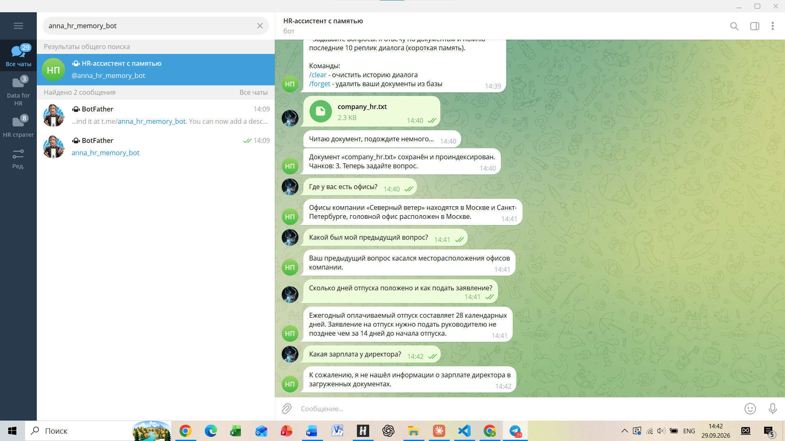

# HR-ассистент в Telegram с короткой и долгой памятью

Домашнее задание к уроку 6 «Память в ИИ» (программа Вайб-кодер»). Вариант: **комбинированная память**.

Бот отвечает на вопросы сотрудников по загруженным документам (долгая память) и при этом ведёт связный диалог, помня последние реплики (короткая память).

## Как устроена память

**Короткая память** - история диалога.
- Хранится в оперативной памяти (словарь `user_id -> очередь сообщений`).
- Для каждого пользователя запоминаются последние 10 реплик (и вопросы, и ответы бота). Более старые вытесняются автоматически.
- Вся история передаётся модели с каждым запросом, поэтому бот понимает уточняющие вопросы.
- При перезапуске бота история сбрасывается, а команда `/clear` очищает её вручную.

**Долгая память** - документы пользователя в векторной базе.
- Пользователь отправляет файл PDF, DOCX или TXT.
- Из файла извлекается текст, который разбивается на чанки (фрагменты) по 500 символов с перекрытием 50 символов.
- Для каждого чанка OpenAI Embeddings (`text-embedding-3-small`) создаёт эмбеддинг - числовое описание смысла текста.
- Эмбеддинги вместе с метаданными (пользователь, документ, имя файла, номер чанка) сохраняются в локальную векторную базу **ChromaDB** в папке `memory`. Данные сохраняются на диск и не пропадают при перезапуске.
- Команда `/forget` удаляет документы пользователя из базы. Один и тот же файл, загруженный повторно, не дублируется.

## Логика обработки вопроса

1. Вопрос пользователя переводится в эмбеддинг.
2. В Chroma ищутся 5 ближайших по смыслу фрагментов документов этого пользователя. Слишком далёкие по смыслу фрагменты отбрасываются.
3. В запрос к модели собираются: системный промпт, история диалога (короткая память) и найденные фрагменты вместе с вопросом (долгая память).
4. Модель формирует ответ. Системный промпт требует опираться на документы и не выдумывать факты: если ответа в документах нет, бот честно об этом сообщает.
5. Вопрос и ответ добавляются в короткую память (сам вставленный контекст в историю не попадает, чтобы не раздувать её).

Это не обучение модели: документы не «зашиваются» в модель, нужные фрагменты передаются ей в момент запроса.

## Используемые библиотеки

- `aiogram` - Telegram-бот
- `openai` - чат-модель и эмбеддинги
- `chromadb` - векторная база данных
- `pypdf`, `python-docx` - чтение PDF и DOCX
- `python-dotenv` - чтение настроек из `.env`

## Структура проекта

- `bot.py` - код бота
- `company_hr.txt` - тестовый документ (вымышленные данные)
- `requirements.txt` - список библиотек
- `.env.example` - образец настроек (без секретов)
- `.gitignore` - исключает `.env`, `memory/`, `uploads/` из репозитория
- `screenshots/` - скриншот работы бота

## Установка и запуск

1. Создать бота у @BotFather в Telegram и получить токен.
2. Создать и включить виртуальное окружение (Windows PowerShell):

```
python -m venv .venv
.\.venv\Scripts\Activate.ps1
```

3. Установить библиотеки:

```
pip install -r requirements.txt
```

4. Скопировать `.env.example` в `.env` и вписать токен бота и ключ OpenAI:

```
Copy-Item .env.example .env
```

5. Запустить бота:

```
python bot.py
```

## Настройки (файл .env)

- `BOT_TOKEN` - токен Telegram-бота
- `OPENAI_API_KEY` - ключ OpenAI
- `OPENAI_BASE_URL` - адрес API (по умолчанию `https://api.openai.com/v1`)
- `CHAT_MODEL` - модель для ответов (по умолчанию `gpt-4o-mini`)
- `EMBED_MODEL` - модель для эмбеддингов (по умолчанию `text-embedding-3-small`)
- `LOG_LEVEL` - уровень сообщений в терминале

## Команды бота

- `/start` - приветствие
- `/clear` - очистить историю диалога
- `/forget` - удалить загруженные документы из базы

## Пример работы

После загрузки `company_hr.txt`:

- «Где у вас есть офисы?» - бот отвечает по документу: Москва и Санкт-Петербург.
- «Какой был мой предыдущий вопрос?» - бот вспоминает предыдущий вопрос (короткая память).
- «Сколько дней отпуска положено и как подать заявление?» - 28 календарных дней, заявление подаётся не позднее чем за 14 дней.
- «Какая зарплата у директора?» - бот сообщает, что не нашёл этого в загруженных документах, и ничего не выдумывает.



## Ограничения

- Короткая память хранится в оперативной памяти и сбрасывается при перезапуске бота.
- Документ-скан без текстового слоя прочитать нельзя.
- Бот работает, пока запущен `bot.py` на компьютере.
- Данные в `company_hr.txt` вымышленные.
